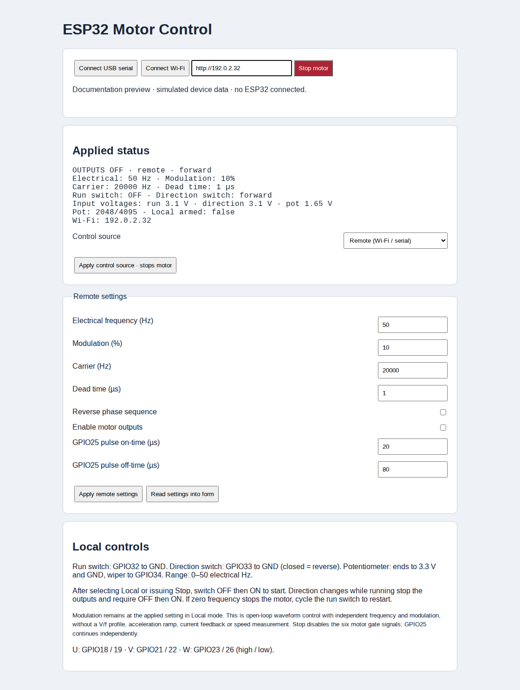

<div align="center">

# ESP32 Motor Control

**Three-phase SVPWM · Wi-Fi dashboard · USB serial · Physical controls**

An ESP32 controller for developing an induction-motor drive, with complementary gate signals, adjustable dead time and live input-voltage monitoring.

[Getting started](docs/GETTING_STARTED.md) · [Wiring & inputs](docs/WIRING.md) · [Control API](docs/CONTROL_API.md) · [Development](docs/DEVELOPMENT.md)

</div>



*The actual `motor-control.html` interface, captured with simulated telemetry and motor outputs OFF. This is a documentation preview, not a hardware measurement. [Mobile screenshot](docs/images/controller-mobile.png).*

## At a glance

| Feature | Current implementation |
| --- | --- |
| Three-phase output | U / V / W complementary high- and low-side signals |
| Modulation | Centered SVPWM using common-mode injection, 1024-entry reference table |
| Switching frequency | 5–20 kHz, adjustable dead time of 0.1–5 µs |
| Electrical frequency | 0–1500 Hz remotely; potentiometer range defaults to 0–50 Hz |
| Browser control | ESP32-hosted page or standalone HTML over Wi-Fi / USB serial |
| Live monitoring | Applied settings, switch states, three input voltages and potentiometer ADC reading |
| Physical controls | Maintained run switch, direction switch and potentiometer |
| Extra output | Independent pulse generator on GPIO25 |
| Target | **Classic ESP32**, Arduino ESP32 core **3.3.12** |

**Project stage:** open-loop waveform control. Frequency and modulation are independent settings. Automatic V/f control, acceleration ramps, current regulation, rotor-speed feedback and hardware fault handling are not implemented. Automatic detection of connected controls also remains pending; the firmware currently uses explicit **Remote / Local** selection.

## Start here

1. Wire the ESP32 inputs and gate-driver signals using the [pin map](docs/WIRING.md).
2. Copy `wifi_config.example.h` to `wifi_config.h` and enter your network credentials. The local file is ignored by Git.
3. Build and upload the sketch using the [setup guide](docs/GETTING_STARTED.md).
4. Open the device address printed at **115200 baud**, or open [motor-control.html](motor-control.html) and connect through USB serial.
5. Read the applied settings and input voltages before enabling outputs.

The motor gate signals boot **OFF** in **Remote** mode. GPIO25 starts generating its independent pulse signal at boot.

## One interface, two control sources

| | Remote | Local |
| --- | --- | --- |
| Run / stop | Wi-Fi or serial commands | Run switch on GPIO32 |
| Direction | Remote setting; stop before changing | Direction switch on GPIO33 |
| Electrical frequency | Remote frequency setting | Potentiometer on GPIO34 |
| Modulation, carrier, dead time | Set through the interface | Retained from the previously applied settings |
| Monitoring | Live status over Wi-Fi or USB | Same live status, including input voltages |

Changing the source stops the motor outputs. In Local mode, observe the run switch **OFF**, then switch **ON** to start. A remote Stop, a direction change while running, or a zero-frequency stop requires a fresh OFF → ON cycle before restarting. A held ON switch cannot undo a remote Stop.

**Stop** disables all six motor gate signals. GPIO25 continues independently. A stopped output does not establish that the rotor is stationary. Losing Wi-Fi or closing the browser leaves the last command active; there is no communication watchdog.

## What the dashboard shows

- **Applied status:** output enable state, source, direction, frequency, modulation, actual carrier and dead time.
- **Analog input readings:** run-switch voltage on GPIO32, direction voltage on GPIO33 and potentiometer voltage on GPIO34.
- **Physical input states:** debounced switch positions, filtered potentiometer ADC value and Local arming state.
- **Controls:** explicit source selection, remote motor settings, independent pulse timing and Stop.

The browser polls once per second; ADC voltages are sampled every 10 ms while the main loop is being serviced. Displayed motor status reflects commands and gate-output state, rather than measured speed or current. Voltages do not currently indicate whether a connector is present; see [input detection limitations](docs/WIRING.md#connection-detection).

## Pin map

| Signal | GPIO |
| --- | --- |
| U high / low | 18 / 19 |
| V high / low | 21 / 22 |
| W high / low | 23 / 26 |
| Independent pulse | 25 |
| Run / direction switches | 32 / 33 |
| Potentiometer wiper | 34 |

Full connections and the potentiometer wiring diagram are in [Wiring & inputs](docs/WIRING.md).

## Documentation

| Guide | Contents |
| --- | --- |
| [Getting started](docs/GETTING_STARTED.md) | Toolchain, credentials, build/upload, Wi-Fi, USB and troubleshooting |
| [Wiring & inputs](docs/WIRING.md) | Pin assignments, physical controls, ADC behavior and connection detection |
| [Control API](docs/CONTROL_API.md) | HTTP and serial commands, limits, JSON fields and examples |
| [Development](docs/DEVELOPMENT.md) | Signal generation, source layout, tests and screenshot reproduction |

## Build and checks

From the project directory:

```sh
python3 web/build.py
arduino-cli compile --fqbn esp32:esp32:esp32 .
node --test tests/*.mjs
python3 tests/test_local_controls.py
```

The transport tests use simulated peers; the input tests run the firmware state machine against simulated GPIO, ADC and time. They do not validate physical gate signals, dead time or motor operation.

Protocol helpers and browser transports were adapted from the ESP32 Function Generator project. Attribution and license text for those components are in [THIRD_PARTY_NOTICES.md](THIRD_PARTY_NOTICES.md).
