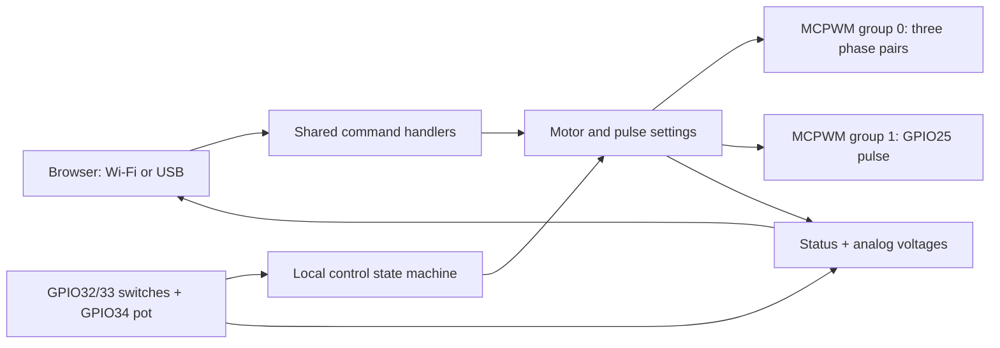

# Development

[← Project overview](../README.md)

## Source layout

| Path | Purpose |
| --- | --- |
| `Esp32MotControl.ino` | PWM peripherals, inputs, HTTP endpoints and serial command parser |
| `wifi_config.example.h` | Public credential template |
| `wifi_config.h` | Ignored local credentials |
| `web/index.html` | Editable interface markup, styles and application logic |
| `web/serial.mjs` | Queued browser USB serial transport |
| `web/http.mjs` | Queued browser HTTP transport |
| `web/build.py` | Generates the standalone and embedded pages |
| `motor-control.html` | Generated standalone controller |
| `web_page.h` | Generated page compiled into the firmware |
| `tests/` | Simulated transport and physical-input checks |
| `docs/capture_ui.py` | Captures the actual HTML with read-only sample telemetry |
| `docs/images/` | Desktop and mobile documentation screenshots |

Edit the web sources rather than the generated files, then run:

```sh
python3 web/build.py
```

Commit both generated files with any web-source change so the standalone page and flashed interface stay aligned. A new embedded page requires rebuilding and uploading firmware.

## Signal generation



The motor uses a 10 MHz timer clock and center-aligned, up/down PWM. A 1024-entry table contains three phase references with min/max common-mode injection for centered SVPWM. At each carrier peak, the interrupt advances a phase accumulator and prepares three compare values. Shadow compares latch at the next zero so all phases update together.

Each phase has complementary high/low signals with hardware dead time. Modulation amplitude is limited to preserve a margin around the dead-time interval. Reverse direction changes the sign of phase progression.

Stopping disconnects all six motor signals from the GPIO output matrix and drives them LOW. The PWM timer continues internally. This avoids retaining the last gate level or leaving an inverted complementary signal asserted when stopped.

GPIO25 uses MCPWM group 1 independently, with a 1 MHz timer clock. Motor Stop does not affect that output. Applying remote settings briefly stops/reconfigures the timers; it is not a smooth frequency ramp. The pulse-timing update includes a wait for the maximum supported pulse period.

## Verification

```sh
node --test tests/*.mjs
python3 tests/test_local_controls.py
arduino-cli compile --fqbn esp32:esp32:esp32 .
```

The JavaScript checks require Node.js with its built-in test runner and Web Streams support. The input check requires Python 3 and `g++`; it extracts the actual firmware input state machine and runs it against simulated GPIO, ADC and time.

| Check | What it covers |
| --- | --- |
| HTTP transport | Request parameters, errors, sequencing, Stop priority and timeouts |
| Serial transport | Fragmented replies, request IDs, boot logs, encoding, validation errors, disconnects and Stop priority |
| Physical input simulation | Entry with switch held ON, OFF/ON arming, Stop persistence, direction changes, zero-frequency restart behavior and voltage reporting |
| ESP32 compilation | Compatibility with the selected board/core and available flash/RAM |
| Screenshot capture | Page rendering, sample-state load, displayed voltages and browser script errors |

These checks do not establish physical PWM timing, dead-time accuracy, current behavior or motor performance. Hardware waveform and power-stage validation is separate.

## Reproduce the screenshots

The screenshot script serves the existing standalone HTML from an ephemeral loopback-only HTTP server. `/state` returns fixed, simulated data; POST requests are rejected. The browser is restricted to that local server. No ESP32 is contacted and no motor command is sent.

Install screenshot tooling in a temporary environment:

```sh
python3 -m venv /tmp/esp32motcontrol-docs-venv
/tmp/esp32motcontrol-docs-venv/bin/pip install playwright
python3 web/build.py
/tmp/esp32motcontrol-docs-venv/bin/python docs/capture_ui.py
```

The script uses an installed `google-chrome` or `chromium` if found. Specify a different executable with `--browser /path/to/browser`. If neither is available, install Playwright's Chromium first:

```sh
/tmp/esp32motcontrol-docs-venv/bin/playwright install chromium
```

Outputs:

- `docs/images/controller-desktop.png` — 1120 px wide, full page.
- `docs/images/controller-mobile.png` — 390 px wide, full page.

The feedback text in each capture explicitly labels the data as simulated. The preview address `192.0.2.32` is a documentation placeholder. The screenshots show motor outputs OFF and do not constitute a live hardware test.

## Current boundaries

Automatic V/f, acceleration/deceleration ramps, current feedback, rotor-speed sensing, hardware fault handling and a communications watchdog are not implemented. The explicit Local/Remote modes remain in use. Automatic input-presence detection depends on a defined circuit and voltage windows; see [Wiring & inputs](WIRING.md#connection-detection).

The protocol helpers and browser transports include code adapted from the ESP32 Function Generator project. Keep the attribution in [THIRD_PARTY_NOTICES.md](../THIRD_PARTY_NOTICES.md) with those components.
